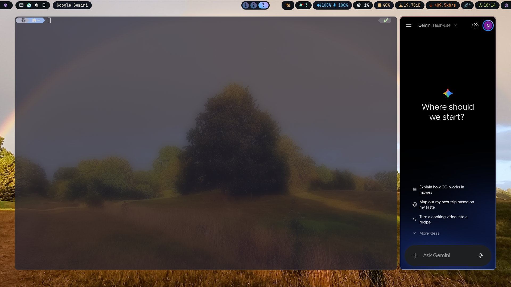
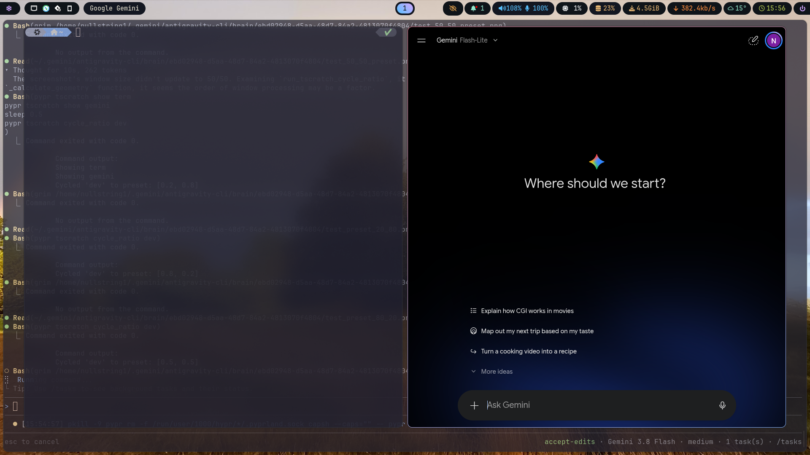
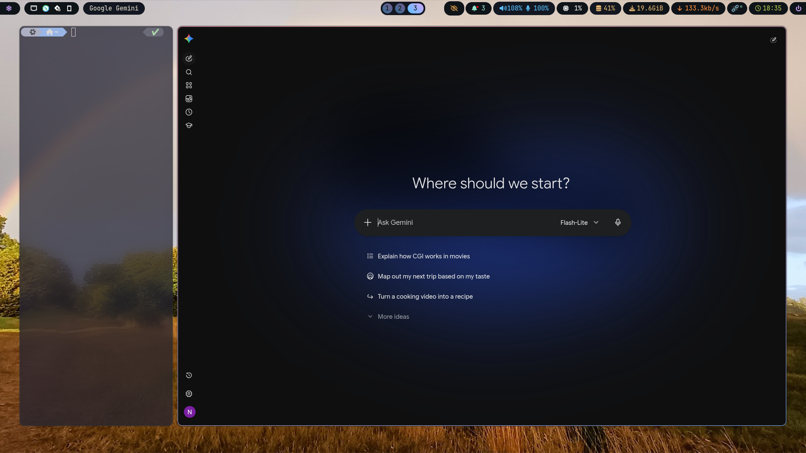
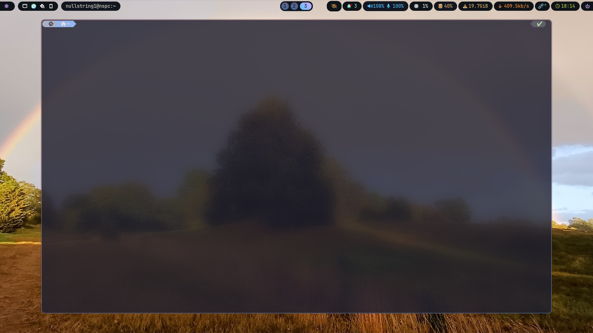
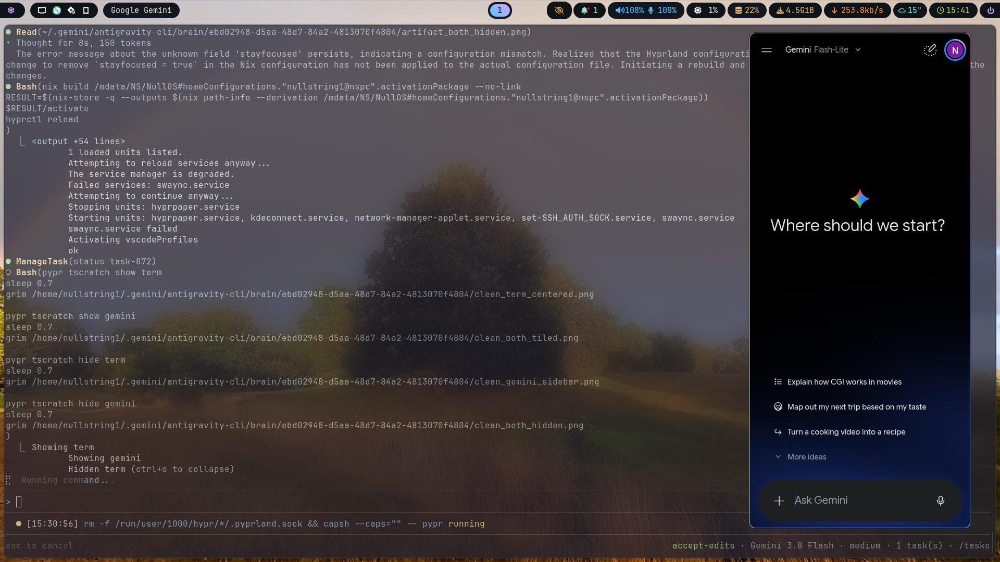

# tscratch — Dynamic Tiled Scratchpads for Hyprland

<p align="center">
  <b>A native Pyprland plugin for compound, dynamically tiled floating scratchpads.</b><br>
  Define cohesive scratchpad groups that tile side-by-side with proportional ratios, enforce min/max constraints, and dynamically recalculate positions based on active visibility.
</p>

---

## Overview

In stock Hyprland and standard scratchpad managers, scratchpads are treated as independent floating windows. Opening a terminal scratchpad and an AI assistant scratchpad causes them to overlap awkwardly, requiring manual repositioning or full-screen tiling that disturbs your active workspace.

**`tscratch`** solves this by introducing **Compound Tiled Scratchpads**:
- **Independent Toggles:** Toggle individual apps (e.g. `SUPER + T` for terminal, `SUPER + G` for AI sidebar) or the entire group.
- **Dynamic Floating Tiling:** When multiple windows in a group are visible, they tile side-by-side or stacked inside a floating container over your current workspace.
- **Smart Solo Auto-Sizing:** When only one window is open, it automatically expands to its `max_width`/`max_height` and centers itself (or snaps to its configured sidebar position).
- **Flexbox-Style Min/Max Clamping:** Enforces `min_width`, `max_width`, `min_height`, and `max_height` bounds, dynamically redistributing remaining container space among unconstrained windows.
- **Runtime Ratio Switching:** Cycle through ratio presets (80/20, 50/50, 20/80) on the fly with a single hotkey (`SUPER + CTRL + T`).
- **Focus Restoration & Auto-Hide:** Restores focus to your previously active window on hide, with optional auto-hide when clicking outside.

---

## Visual Showcase

### Both Windows Open (Default 80/20 Layout)
*Ghostty takes 80% on the left, Brave (Gemini) sits as a 20% right sidebar with a 14px gap.*


### Cycled Presets via `SUPER + CTRL + T`
| 50/50 Equal Split | 20/80 Inverted Split (Clamped to Constraints) |
|---|---|
|  |  |

### Solo Views
| Terminal Solo (Centered, Auto Max Size) | Gemini Solo (Right Sidebar) |
|---|---|
|  |  |

---

## Installation

### Standard Setup

1. Copy `tscratch.py` into your Pyprland plugins directory:
   ```bash
   mkdir -p ~/.config/pypr/plugins
   cp tscratch.py ~/.config/pypr/plugins/tscratch.py
   ```

2. Add `external:tscratch` to your `~/.config/pypr/config.toml`:
   ```toml
   [pyprland]
   plugins_paths = ["~/.config/pypr/plugins"]
   plugins = [
     "scratchpads",
     "external:tscratch"
   ]
   ```

3. Reload Pyprland:
   ```bash
   pypr reload
   ```

---

### NixOS / Flake Setup (Recommended)

1. **Add `tscratch` to your `flake.nix` inputs**:
   ```nix
   inputs = {
     nixpkgs.url = "github:NixOS/nixpkgs/nixos-unstable";
     tscratch.url = "github:nullstring1/tscratch"; # or path to local checkout
   };
   ```

2. **Apply the overlay** in your NixOS or Home Manager configuration:
   ```nix
   nixpkgs.overlays = [
     inputs.tscratch.overlays.default
   ];
   ```
   *The overlay automatically injects `tscratch` directly into `pkgs.pyprland`'s Python environment. No manual file copying or `plugins_paths` needed!*

3. **Install the package and configure `~/.config/pypr/config.toml`**:
   ```nix
   { pkgs, ... }:
   {
     home.packages = with pkgs; [
       pyprland  # Automatically includes tscratch via overlay
     ];

     home.file.".config/pypr/config.toml".text = ''
       [pyprland]
       plugins = [
         "scratchpads",
         "external:tscratch"
       ]

       [tscratch.dev]
       width = "94%"
       height = "88%"
       top = "6%"
       gap = 14
       orientation = "horizontal"
       layout = "columns"
       restore_focus = true
       presets = [
         [0.8, 0.2],
         [0.5, 0.5],
         [0.2, 0.8]
       ]

       [tscratch.dev.windows.term]
       command = "ghostty --class=scratchpad.ghostty"
       class = "scratchpad.ghostty"
       ratio = 0.8
       min_width = "350px"
       max_width = "1650px"
       min_height = "500px"
       max_height = "950px"
       animation = "fromTop"

       [tscratch.dev.windows.gemini]
       command = "brave --profile-directory=Default --app=https://gemini.google.com/app"
       initialClass = "brave-gemini.google.com__app-Default"
       ratio = 0.2
       min_width = "340px"
       max_width = "1650px"
       min_height = "600px"
       max_height = "980px"
       animation = "fromRight"
       solo_position = "right"
       solo_width = "420px"
     '';
   }
   ```

---

### Manual Setup (Without Flakes)

In your Home Manager configuration (e.g. `pyprland.nix`):

```nix
{ pkgs, config, ... }:
{
  home.packages = with pkgs; [ pyprland ];

  # Link plugin manually
  home.file.".config/pypr/plugins/tscratch.py".source = ./tscratch.py;

  # Pyprland configuration
  home.file.".config/pypr/config.toml".text = ''
    [pyprland]
    plugins_paths = ["${config.home.homeDirectory}/.config/pypr/plugins"]
    plugins = [
      "scratchpads",
      "external:tscratch"
    ]
    ...
  '';
}
```

  # Recommended: Supervised systemd user service with automated stale socket cleanup
  systemd.user.services.pyprland = {
    Unit = {
      Description = "Pyprland daemon";
      PartOf = [ "hyprland-session.target" ];
      After = [ "hyprland-session.target" ];
    };
    Service = {
      ExecStartPre = "${pkgs.writeShellScript "pypr-cleanup" ''
        rm -f ''${XDG_RUNTIME_DIR:-/run/user/1000}/hypr/*/.pyprland.sock
      ''}";
      ExecStart = "${pkgs.libcap}/bin/capsh --caps= -- -c '${pkgs.pyprland}/bin/pypr'";
      Restart = "on-failure";
      RestartSec = 1;
    };
    Install = {
      WantedBy = [ "hyprland-session.target" ];
    };
  };
}
```

---

## Configuration Reference

### Group Settings (`[tscratch.<group_name>]`)

| Key | Type | Default | Description |
|---|---|---|---|
| `width` | `string` (`%` / `px`) | `"94%"` | Bounding container width relative to active monitor |
| `height` | `string` (`%` / `px`) | `"88%"` | Bounding container height relative to active monitor |
| `top` | `string` (`%` / `px`) | `"6%"` | Top margin offset from monitor top edge |
| `left` | `string` (`%` / `px`) | `""` (auto) | Left offset; auto-centers horizontally when omitted |
| `gap` | `int` (px) | `14` | Inner gap between adjacent tiled windows |
| `orientation` | `string` | `"horizontal"` | Tiling axis: `"horizontal"` (columns) or `"vertical"` (rows) |
| `layout` | `string` | `"columns"` | Layout engine: `"columns"` or `"master-stack"` (for 3+ windows) |
| `master_ratio` | `float` | `0.7` | Size ratio for master window in `master-stack` layout |
| `order` | `list[string]` | `[]` | Explicit left-to-right window ordering |
| `presets` | `list[list[float]]` | `[[0.8, 0.2], ...]` | Preset ratio cycles for `pypr tscratch cycle_ratio` |
| `restore_focus` | `bool` | `true` | Restores keyboard focus to previous active window on hide |
| `hide_on_focus_lost` | `bool` | `false` | Automatically hide all group windows when clicking onto desktop |
| `pinned` | `bool` | `false` | Pin floating scratchpads across all workspaces |
| `monitor` | `string` | `"active"` | Target monitor name (`"active"` follows focused monitor) |

### Window Settings (`[tscratch.<group_name>.windows.<window_name>]`)

| Key | Type | Default | Description |
|---|---|---|---|
| `command` | `string` | `""` | Command to spawn application if not running |
| `class` | `string` | `""` | Match window by `class` |
| `initialClass` | `string` | `""` | Match window by `initialClass` (e.g. Brave PWAs) |
| `title` | `string` | `""` | Match window by `title` |
| `ratio` | `float` | `1.0` | Proportional weight when tiled together with other windows |
| `min_width` | `string` (`%` / `px`) | `""` | Minimum width clamp (e.g. `"750px"` or `"25%"`) |
| `max_width` | `string` (`%` / `px`) | `""` | Maximum width clamp (e.g. `"1650px"` or `"85%"`) |
| `min_height` | `string` (`%` / `px`) | `""` | Minimum height clamp (e.g. `"500px"` or `"50%"`) |
| `max_height` | `string` (`%` / `px`) | `""` | Maximum height clamp (e.g. `"950px"` or `"90%"`) |
| `solo_position` | `string` | `"center"` | Placement when alone: `"center"`, `"right"`, `"left"`, `"top"`, `"bottom"` |
| `solo_width` | `string` (`%` / `px`) | `"auto"` | Solo width; defaults to `max_width` or container width |
| `solo_height` | `string` (`%` / `px`) | `"auto"` | Solo height; defaults to `max_height` or container height |
| `animation` | `string` | `""` | Slide direction: `"fromTop"`, `"fromRight"`, `"fromLeft"`, `"fromBottom"` |
| `close_on_hide` | `bool` | `false` | Terminate process on hide rather than parking in special workspace |
| `pinned` | `bool` | `false` | Per-window pin override |

---

## CLI Commands

Interact with `tscratch` via the `pypr` CLI tool:

```bash
# Toggle a specific window (animates and re-tiles open windows)
pypr tscratch toggle <window_name>

# Explicit show / hide
pypr tscratch show <window_name>
pypr tscratch hide <window_name>

# Group controls
pypr tscratch toggle_all [group]
pypr tscratch hide_all

# Runtime ratio adjustments
pypr tscratch ratio <group> <r1> <r2> ...    # e.g., pypr tscratch ratio dev 0.6 0.4
pypr tscratch cycle_ratio [group]             # Cycles through configured presets

# Window focus & layout manipulation
pypr tscratch cycle [group]                  # Focus next visible window in group
pypr tscratch swap <win1> <win2>             # Swap display order of two windows
```

---

## Keybinding Examples

### Standard Hyprland (`hyprland.conf`)
```ini
bind = SUPER, T, exec, pypr tscratch toggle term
bind = SUPER, G, exec, pypr tscratch toggle gemini
bind = SUPER CTRL, T, exec, pypr tscratch cycle_ratio dev
bind = SUPER SHIFT, T, exec, pypr tscratch hide_all
```

### Hyprland Lua Mode (`hyprland.lua`)
```lua
hl.bind("SUPER", "T", hl.dsp.exec_cmd("pypr tscratch toggle term"))
hl.bind("SUPER", "G", hl.dsp.exec_cmd("pypr tscratch toggle gemini"))
hl.bind("SUPER + CTRL", "T", hl.dsp.exec_cmd("pypr tscratch cycle_ratio dev"))
hl.bind("SUPER + SHIFT", "T", hl.dsp.exec_cmd("pypr tscratch hide_all"))
```

---

## License

MIT
